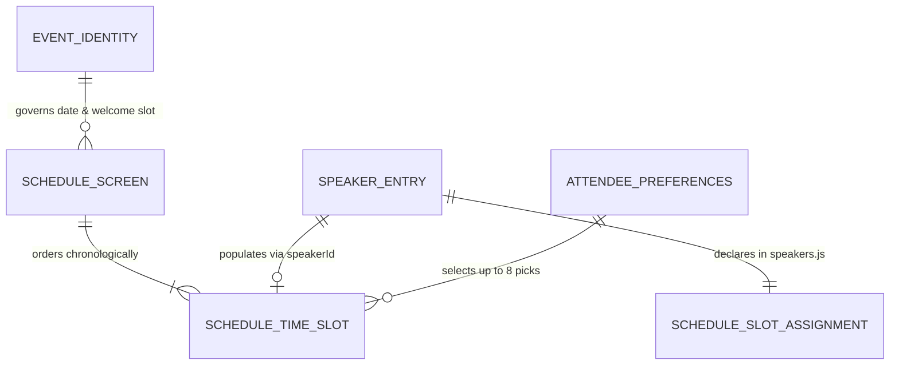

# Data Model: 80s Miami Vice / New Wave Conference Rebrand & Visual Overhaul

**Feature**: `001-miami-vice-rebrand`  
**Date**: 2026-11-27  
**Specification**: `specs/001-miami-vice-rebrand/spec.md`

---

## 1. Entity Overview & Relationships

All conference content is statically authored in ES modules at the repository root (`event.js`, `speakers.js`, `schedule.js`) and statically exported by Next.js (`output: "export"`). Attendee preferences live client-side in `window.localStorage` (with URL-hash sharing for itinerary picks and in-memory session fallback when storage is unavailable).

---

## 2. Entities & Field Specifications

### 2.1 `EventIdentity` (`event.js`)

Represents the current-edition conference identity consumed across headers, hero lockups, footers, structured JSON-LD metadata, and `<head>` OpenGraph tags.

| Field | Type | Value / Rule | Notes |
|---|---|---|---|
| `title` | `string` | `"Dan Beglins Mega Brum Tech Fest"` | Exact spelling required by FR-001; replaces `"TechMids Conf"` |
| `tagline` | `string` | `"Better than tech mids"` | Primary hero tagline required by FR-002 |
| `organizerName` | `string` | `"Dan Beglins Mega Brum Tech Fest"` | Replaces `"TechMids"` in footer attribution and JSON-LD `organizer.name` |
| `year` | `string` | `"2026"` | Retained |
| `date` | `string` | `"27th November 2026"` | Retained |
| `isoDate` | `string` | `"2026-11-27"` | Retained; also scopes `localStorage` pick keys |
| `dateTbc` | `boolean` | `false` | Retained |
| `venue` | `string` | `"Everyman Cinema"` | Retained |
| `address` | `string` | `"Mailbox, Birmingham"` | Retained |
| `streetAddress` | `string` | `"The Mailbox, 116 Commercial St"` | Retained |
| `postalCode` | `string` | `"B1 1RF"` | Retained |
| `startTime` | `string` | `OVERALL_START` (`"08:30AM"`) | Imported from `schedule.js` |
| `endTime` | `string` | `OVERALL_END` (`"17:15PM"`) | Imported from `schedule.js` |
| `speakersTBC` | `boolean` | `false` | All 24 session slots populated |
| `edition` (getter) | `string` | `"Dan Beglins Mega Brum Tech Fest"` (or `"Dan Beglins Mega Brum Tech Fest 2026"` where year-qualified) | Exposed via getter so existing `${EVENT.edition}` consumers stay valid |

**Validation Rules**:
- Zero occurrences of `"TechMids Conf"` or `"Tech Mids"` may remain in current-edition UI chrome, metadata, welcome slot descriptions, or copyright notices (FR-001, SC-001).
- Historical archive records in `src/components/PastEventsList.jsx` and dated historical attendee quotes in `src/components/Testimonials.jsx` are explicitly exempt and retain their original historical titles.

---

### 2.2 `SpeakerEntry` & `ScheduleSlotAssignment` (`speakers.js`)

Per Architectural Constraint #1, **all** speaker profiles, keynote flags, and session slot assignments are authored exclusively inside `speakers.js` under `export const Sessions`, preserving its existing object map schema and export signature.

| Field | Type | Required | Validation Rule / Constraint |
|---|---|---|---|
| `[speakerId]` (map key) | `string` | Yes | PascalCase URL-safe slug (`^[A-Za-z0-9]+$`); generates `/speakers/[speaker]` route and pick ID |
| `name` | `string` | Yes | Non-empty display name; supports joint co-speakers (`"Lucia Caminos & Jason Duval"`) |
| `jobTitle` | `string` | Yes | Non-empty role/company string |
| `bio` | `JSX.Element` | Yes | React fragment (`<>...</>`) containing `
` biography paragraphs (or `<></>` if concise) |
| `talkTitle` | `string` | Yes | Non-empty session title |
| `description` | `JSX.Element` | Yes | React fragment (`<>...</>`) containing `
` talk abstract paragraphs |
| `image` | `StaticImageData` | Yes | Static ES module import (`{ src: string, width: number, height: number }`) from `./public/speakers/*.jpeg` or `./public/assets/*.svg` |
| `sessionType` | `"Keynote" \| "Talk"` | Yes | `"Keynote"` exclusively for `"DanBeglin"` (renders neon `"HEADLINER"` badge on `/` while keeping `/new` `sessionType === 'Keynote'` intact); `"Talk"` for all other 23 entries |
| `slot` | `{ screen: ScreenId, start: string, end: string }` | Yes | Additive slot assignment (`screen1 \| screen2 \| screen3` + canonical slot start/end); must form a bijection across all 24 `(screen, timeWindow)` pairs |
| `speakerCard` | `boolean` | Yes | Preserved boolean (`false` default) |
| `speakerCardImage` | `string` | Yes | Preserved string (`""` default) |
| `website`, `linkedin`, `github`, `x`, `bluesky`, `mastodon`, `instagram`, `youtube`, `facebook`, `devto`, `tiktok` | `string` | Optional | Optional social profile URLs / handles consumed by `SOCIALS` in `Speaker.jsx` |

#### Featured & Updated Speaker Mutations in `speakers.js`

| Action | `speakerId` | `name` | `jobTitle` | `sessionType` | `talkTitle` | Portrait Asset | Assigned `slot` |
|---|---|---|---|---|---|---|---|
| **Removed** | `SimonStevens` | Simon Stevens | — | — | — | Removed import | Vacates `screen3` `09:45 AM – 10:30 AM` |
| **Removed** | `MikolajMaciejak` | Mikolaj Maciejak | — | — | — | Removed import | Vacates `screen2` `11:15 AM – 12:00 PM` |
| **Updated & Promoted** | `DanBeglin` | Dan Beglin | `Founder & Chief Synthwave Architect` | `"Keynote"` (UI badge: `HEADLINER`) | `Why Mega Brum Tech Fest Beats Everything Else` | `./public/speakers/DanBeglin.jpeg` | `screen3`, `09:45 AM` – `10:30 AM` (moves from `screen1` `16:30 PM`) |
| **Added (Co-Speakers)** | `LuciaCaminosJasonDuval` | Lucia Caminos & Jason Duval | `Staff Co-Founders @ Leonida Systems` | `"Talk"` | `Pair Programming Under Pressure: Shipping Fast When the Heat Is On` | `./public/assets/lucia-jason.svg` (`800×800` full-color retro SVG) | `screen2`, `11:15 AM` – `12:00 PM` |
| **Added** | `KenRosenberg` | Ken Rosenberg | `Principal Incident & Compliance Counsel @ Rosenberg & Associates` | `"Talk"` | `Don't Panic! Survive P1 Production Outages Without Losing Your License` | `./public/assets/ken-rosenberg.svg` (`800×800` full-color retro SVG) | `screen1`, `16:30 PM` – `17:15 PM` |

#### Complete 24-Slot Allocation Matrix (8 Windows × 3 Screens)

| Window | Time (`start` – `end`) | `Screen 1` (Hot Magenta) | `Screen 2` (Electric Cyan) | `Screen 3` (Solar Amber / Violet) |
|---|---|---|---|---|
| Shared | `08:30AM` – `09:30AM` | Registration (`conferenceSchedule`) | — | — |
| Shared | `09:30AM` – `09:45AM` | Welcome (`Welcome to Dan Beglins Mega Brum Tech Fest!`) | Welcome (shared) | Welcome (shared) |
| **Slot 1** | `09:45 AM` – `10:30 AM` | `FaithSodipe` | `RichardTweed` | **`DanBeglin` (Keynote / HEADLINER)** |
| **Slot 2** | `10:30 AM` – `11:15 AM` | `OliverDavies` | `MikeIrving` | `BeckiFloyd` |
| **Slot 3** | `11:15 AM` – `12:00 PM` | `EriolFox` | **`LuciaCaminosJasonDuval`** | `MartinReynolds` |
| Shared | `12:00PM` – `13:00PM` | Lunch (shared) | Lunch (shared) | Lunch (shared) |
| **Slot 4** | `13:00 PM` – `13:45 PM` | `RobertCurran` | `CliffAgius` | `BruceLawson` |
| **Slot 5** | `13:45 PM` – `14:30 PM` | `EdaEren` | `SteveHeyes` | `StevenTrotter` |
| Shared | `14:30PM` – `15:00PM` | Afternoon Break (shared) | Afternoon Break (shared) | Afternoon Break (shared) |
| **Slot 6** | `15:00 PM` – `15:45 PM` | `MatheusGuimaraes` | `ColindaLatour` | `JimSeconde` |
| **Slot 7** | `15:45 PM` – `16:30 PM` | `SteveWade` | `AndyCarter` | `KevlinHenney` |
| **Slot 8** | `16:30 PM` – `17:15 PM` | **`KenRosenberg`** | `ShaunLawrence` | `LiamWestley` |

**Invariants**:
1. `Object.keys(Sessions).length === 24`.
2. Exactly `1` entry has `sessionType === "Keynote"` (`DanBeglin`); `23` entries have `sessionType === "Talk"`.
3. Every `(screen, slotWindow)` cell across the 8 talk windows and 3 screens has exactly `1` assigned speaker (`8 × 3 = 24`), with `0` empty talk cells and `0` duplicate speaker appearances (FR-006, SC-003).

---

### 2.3 `ScheduleScreen` & Derived `Schedule` Map (`schedule.js`)

`schedule.js` reads `Sessions` from `speakers.js` and exposes the unchanged `Schedule` export structure required by `src/components/Schedule.jsx`, `src/picks/usePicks.js`, and `src/new/data.js`.

| Export / Key | Type | Ordering & Accent Mapping |
|---|---|---|
| `OVERALL_START` | `string` | `'08:30AM'` |
| `OVERALL_END` | `string` | `'17:15PM'` |
| `Schedule.conferenceSchedule.day1` | `TrackSchedule` | Overall day outline (`Registration`, `Welcome`, `Morning Sessions`, `Lunch`, `Afternoon Sessions`, `Afternoon Break`, `Late Afternoon Sessions`) |
| `Schedule.screen1.day1` | `TrackSchedule` | `room: "Screen 1"`, ordered chronologically; styled on `/` with `--mv-screen-1-*` tokens |
| `Schedule.screen2.day1` | `TrackSchedule` | `room: "Screen 2"`, ordered chronologically; styled on `/` with `--mv-screen-2-*` tokens |
| `Schedule.screen3.day1` | `TrackSchedule` | `room: "Screen 3"`, ordered chronologically; styled on `/` with `--mv-screen-3-*` tokens |

---

### 2.4 `AttendeePreferences` (Client-Side State Models)

#### A. `ThemePreference`
- **Values**: `'miami-night'` (unconditional default) | `'pastel-day'`
- **DOM Binding**: `<html data-theme="miami-night">` or `<html data-theme="pastel-day">`
- **Storage Key**: `localStorage['theme']`
- **State Transitions**:
  1. **Initial HTML SSR/Export**: `<Html data-theme="miami-night">` rendered statically.
  2. **Pre-Paint Bootstrap (`<head>` inline script)**:
     - Reads `localStorage.getItem('theme')` inside `try/catch`.
     - If `'pastel-day'`, sets `document.documentElement.setAttribute('data-theme', 'pastel-day')`.
     - For `null`, `'miami-night'`, legacy `'dark'`/`'light'`, or thrown `SecurityError`, sets `'miami-night'`.
  3. **User Toggle (`ThemeSwitcher` click / `Enter` / `Space`)**:
     - Flips `miami-night ↔ pastel-day` synchronously on `document.documentElement.dataset.theme`, updates React button `aria-pressed` / active label state immediately, and writes to `localStorage.setItem('theme', nextTheme)` inside `try/catch`.

#### B. `MyDayItinerary` (`src/picks/usePicks.js` + `Schedule.jsx`)
- **Values**: Array of selected `speakerId` strings (`0` to `8` active picks, at most `1` per pickable time window).
- **Storage Key**: `localStorage['techmids:picks:2026-11-27']` and `localStorage['techmids:pick-changes:2026-11-27']` (unchanged for backward compatibility and reconciliation).
- **Derived Counter Readout**:
  - `pickedCount`: integer `0..8`
  - `totalPickable`: integer `8`
  - Formatted VCR LED display string: `` `${String(pickedCount).padStart(2, '0')}/${String(totalPickable).padStart(2, '0')}` `` (e.g., `00/08` → `03/08` → `08/08`).
- **State Transitions**:
  - `Empty (00/08)` → Pick talk → `Active (01/08 .. 08/08)` (competing talks in same time row enter `passedOver` dimmed state; share/clear buttons enable).
  - Pick competing talk in same time row → Replaces row's pick atomically (`pickedCount` unchanged).
  - Unpick active talk or click `Clear picks` → Decrements or resets to `00/08`.
  - Returning visitor with stale `SimonStevens`, `MikolajMaciejak`, or `16:30 DanBeglin` pick → `reconcile()` moves stale entry into `changes[]` alert banner (`gone` or `moved`) and recalculates `pickedCount` cleanly.

